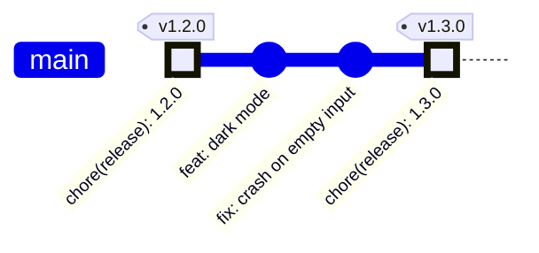
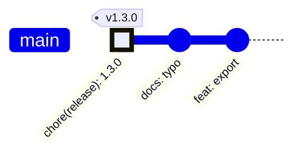
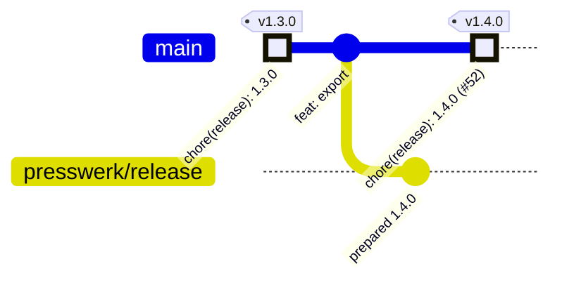
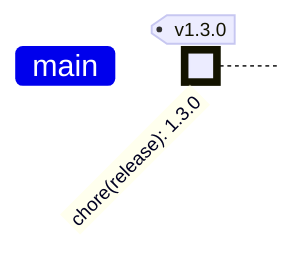
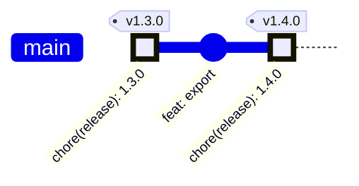
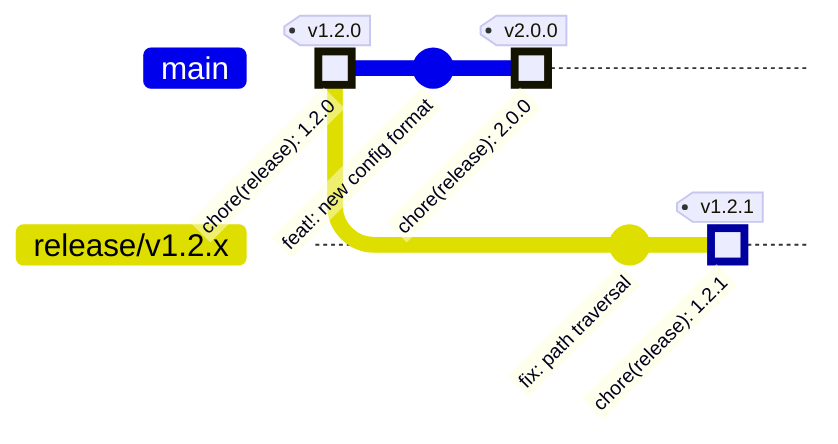
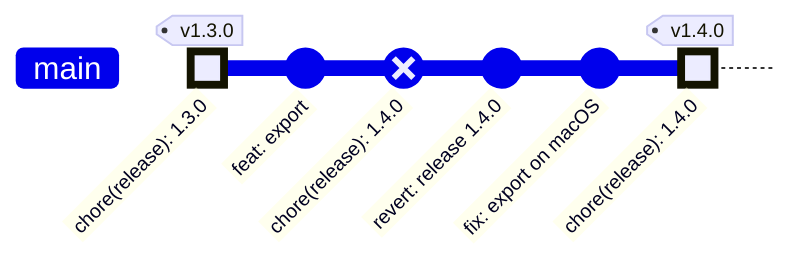
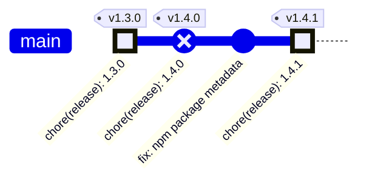
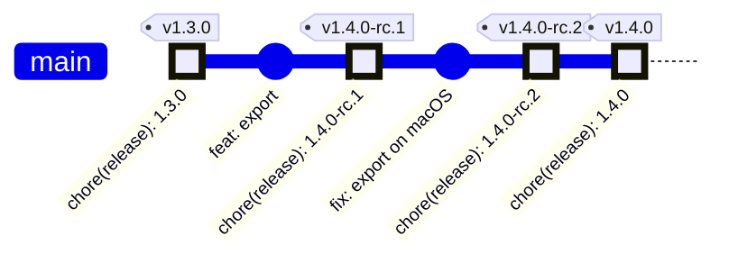
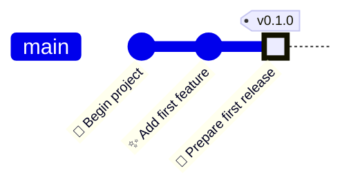

# Scenarios

Concrete release cases, each with a Git graph and the terminal session a developer would see.
Everything here is illustrative: command names, flags, and output are sketches meant to try
out the developer experience before the design settles. Many scenarios describe later features;
the first milestone prioritizes automatic CI-driven self-release.

The examples assume:

- the commands `plan`, `prepare`, and `publish` (see [product shape](product-shape.md#rust-cli));
- notes are committed together with the version as a new section in `CHANGELOG.md` (see
  [release model](release-model.md#changelogs));
- tags are annotated and named `v<version>`;
- the rule from [release flow](release-model.md#release-flow): a commit is a release only when
  it changes the version compared to its parent. Whether its tag is missing, matching, or
  conflicting decides what `publish` does with it. There is no other way to release.

In the graphs, release commits are highlighted. Tags are drawn on the commit they point at,
but they are created by `publish`, after CI passed, not by `prepare`.

## 1. Direct release on main

The simplest case: a personal repository where `prepare` may push to `main`.



Locally, the developer previews and then prepares the release:

```console
$ presswerk plan
presswerk.default  github:owner/project  main @ 4f2a91c

previous release   v1.2.0 (a1b2c3d)
commits since      2  (1 feat, 1 fix)
next version       1.3.0  (minor, because of feat)

version files
  Cargo.toml       1.2.0 -> 1.3.0
  flake.nix        1.2.0 -> 1.3.0

notes
  ## 1.3.0
  ### Features
  - dark mode
  ### Fixes
  - crash on empty input

Nothing written. Run `presswerk prepare` to commit 1.3.0.

$ presswerk prepare --push
committed  9c0ffee  chore(release): 1.3.0
pushed     main

CI now runs on 9c0ffee. `presswerk publish` releases it once CI passed.
```

CI runs on `9c0ffee`, and the release job calls `publish` after all checks passed:

```console
$ presswerk publish
candidate  9c0ffee  1.3.0  tag v1.3.0 missing -> new release

tag      v1.3.0 (annotated)          missing  -> created
crates   project 1.3.0               missing  -> published
github   release v1.3.0 (draft)      missing  -> created
         presswerk-x86_64-linux      missing  -> uploaded
         presswerk-aarch64-darwin    missing  -> uploaded
         release v1.3.0              draft    -> published

Released 1.3.0.
```

The GitHub release stays a draft until all of its assets are uploaded and verified, so it is
not published with missing assets.

## 2. Ordinary commits after a release

`publish` runs on every push to a release branch. For most commits there is nothing to do.



```console
$ presswerk publish
candidate  77aa001  1.3.0  tag v1.3.0 is on 9c0ffee, an ancestor -> not a release

Nothing to do.
```

## 3. Release through a preparation branch, squash-merged

Not part of the first release, and not designed to the end yet (see
[preparation branches](release-model.md#preparation-branches-later)). `prepare` puts the
release commit on a separate branch. People can still edit the notes there. The squash merge
creates a new commit; that commit is the candidate, and the prepared commit is never released.



```console
$ presswerk prepare --branch presswerk/release --push
committed  5e1a2b3  chore(release): 1.4.0  on presswerk/release
pushed     presswerk/release

Merge presswerk/release into main to release. CI on the merged commit runs `presswerk publish`.
```

After the merge, CI on `main` sees version `1.4.0` without a tag and releases the merge commit,
exactly like scenario 1.

## 4. Retry after a partial failure

crates.io was unreachable halfway through. The tag already exists, so the version is used up.
The fix is to rerun the same job.



First run:

```console
$ presswerk publish
candidate  9c0ffee  1.3.0  tag v1.3.0 missing -> new release

tag      v1.3.0 (annotated)          missing  -> created
crates   project 1.3.0               unknown  -> failed: connection reset

Release 1.3.0 is incomplete. Rerun `presswerk publish` on 9c0ffee to finish it.
```

Rerun of the same job:

```console
$ presswerk publish
candidate  9c0ffee  1.3.0  tag v1.3.0 on this commit -> completing release

tag      v1.3.0 (annotated)          matching -> kept
crates   project 1.3.0               missing  -> published
github   release v1.3.0 (draft)      missing  -> created
         presswerk-x86_64-linux      missing  -> uploaded
         presswerk-aarch64-darwin    missing  -> uploaded
         release v1.3.0              draft    -> published

Released 1.3.0.
```

## 5. Republish from a tag

Months later, a release asset was deleted by accident. Any machine with access can republish
the release from its tag.



```console
$ presswerk publish v1.3.0
candidate  9c0ffee  1.3.0  tag v1.3.0 on this commit -> republishing

tag      v1.3.0 (annotated)          matching -> kept
crates   project 1.3.0               matching -> kept
github   release v1.3.0              matching -> kept
         presswerk-x86_64-linux      matching -> kept
         presswerk-aarch64-darwin    missing  -> uploaded

Released 1.3.0. 1 pressing restored.
```

## 6. Maintenance release on a release line

`2.0.0` is out, but `1.2.x` still gets security fixes on `release/v1.2.x`. The previous
release for `1.2.1` is `v1.2.0`, not the newer `v2.0.0`, because the committed version on the
branch is `1.2.0` (see [release model](release-model.md#previous-release)).



```console
$ git switch release/v1.2.x
$ presswerk plan
presswerk.default  github:owner/project  release/v1.2.x @ d00d1e5

previous release   v1.2.0 (a1b2c3d)
commits since      1  (1 fix)
next version       1.2.1  (patch, because of fix)
...
```

## 7. Release commit fails CI

The release commit is built and tested like any other commit, and the version may be used by
derivations and checks. So it can fail CI. It has no tag yet, so the version is not used up.

A fixup commit on top does not help: only the release commit itself can be released, so
`publish` refuses the fixup. The recovery is a revert, then a fresh `prepare`.

```console
$ presswerk publish
pending release  1.4.0 at 3b4c5d6 is not published yet
4d5e6f7 is not a release commit. If 3b4c5d6 failed, run `presswerk revert` and
`presswerk prepare` to release again.
```

`publish` exits with failure while the later commit inherits this untagged release version.
The diagnostic reports a pending release; Git alone does not establish whether its CI has
failed or is still running (see [pending releases](release-model.md#pending-releases)).



```console
$ presswerk revert --push
reverting  3b4c5d6  chore(release): 1.4.0  (failed CI, not tagged)
committed  8e9f0a1  revert: release 1.4.0
pushed     main

Version is back at 1.3.0. Fix the problem, then run `presswerk prepare` again.
```

A revert only helps while the version is still free, that is, before `publish` pushed the tag.
It never deletes a tag.

## 8. Bug in the press

The release commit passed CI. `publish` pushed the tag and published to PyPI, then the npm
publisher hit a bug in Presswerk itself. The master record is fine.

```console
$ presswerk publish
candidate  9c0ffee  1.4.0  tag v1.4.0 missing -> new release

tag      v1.4.0 (annotated)          missing  -> created
pypi     project 1.4.0               missing  -> published
npm      project 1.4.0               missing  -> failed: internal error in npm publisher

Release 1.4.0 is incomplete.
```

After a Presswerk release with the fix, the same tag is republished with the newer CLI:

```console
$ presswerk --version
presswerk 0.7.1
$ presswerk publish v1.4.0
candidate  9c0ffee  1.4.0  tag v1.4.0 on this commit -> completing release

tag      v1.4.0 (annotated)          matching -> kept
pypi     project 1.4.0               matching -> kept
npm      project 1.4.0               missing  -> published
github   release v1.4.0              missing  -> created

Released 1.4.0.
```

This only works because the press is not part of the master record (see
[product shape](product-shape.md#the-press-is-not-part-of-the-master)). If the consumer pins
the CLI in its dev shell, a newer CLI can still be run from outside. Only a bug in code that is
part of the master record, such as the flake-parts module, turns this into scenario 9.

## 9. Bug in the master record

Same start, but npm rejects the package because its metadata, built by the flake, is invalid.
No Presswerk update can change that commit. 1.4.0 stays partial: it is on PyPI, not on npm,
and has no forge release.



```console
$ presswerk publish v1.4.0
candidate  9c0ffee  1.4.0  tag v1.4.0 on this commit -> completing release

tag      v1.4.0 (annotated)          matching -> kept
pypi     project 1.4.0               matching -> kept
npm      project 1.4.0               missing  -> rejected: invalid package.json

Release 1.4.0 cannot be completed from its master record.
Fix the problem and release the next version with `presswerk prepare`.
```

## 10. Freeing a version after a tag-only failure

`publish` pushed the tag `v1.4.0`, then the run died before writing anything else, for example
because the runner was cancelled. No destination holds 1.4.0. The developer makes sure no other
`publish` for 1.4.0 is running and frees the version explicitly:

```console
$ presswerk revert --impure-cleanup --push
v1.4.0 on 9c0ffee
  tag      v1.4.0                    exists   -> will be deleted
  pypi     project 1.4.0             missing
  npm      project 1.4.0             missing
  github   release v1.4.0            missing

Only the tag was written. Make sure no publish for 1.4.0 is running.
Clones that already fetched v1.4.0 keep it.
Continue? [y/N] y

committed  8e9f0a1  revert: release 1.4.0
deleted    tag v1.4.0 (unchanged since inspection)
pushed     main
```

Had any destination held 1.4.0, the command would have refused:

```console
$ presswerk revert --impure-cleanup
v1.4.0 on 9c0ffee
  pypi     project 1.4.0             exists

error: 1.4.0 is already published on pypi and cannot be freed.
       Fix forward: release the fix as the next version with `presswerk prepare`.
```

## 11. Continuous release candidates

CI runs `presswerk prepare --pre rc --push` on every push to main, and `publish` releases each
candidate. A human promotes to a stable release by running `prepare` without `--pre`.



In CI, after the push of `fix: export on macOS`:

```console
$ presswerk prepare --pre rc --push
previous release   v1.4.0-rc.1 (5d6e7f8)
commits since      1  (1 fix)
next version       1.4.0-rc.2

committed  6e7f8a9  chore(release): 1.4.0-rc.2
pushed     main
```

The runtime runs CI for the exact release commit. It is the candidate to publish, not a later
commit inheriting a pending version. Once its checks pass, `publish` creates `v1.4.0-rc.2`.
A later commit encountered before publication would instead report the pending release and
fail.

After `publish` created `v1.4.0-rc.2`, the next push to main runs `prepare` normally, with
`v1.4.0-rc.2` as the previous release.

Later, a human promotes the candidate. The notes cover everything since the last stable
release:

```console
$ presswerk prepare --push
previous release   v1.3.0 (9c0ffee)    highest stable ancestor, base of 1.4.0-rc.2
commits since      2  (1 feat, 1 fix)
next version       1.4.0

committed  7f8a9b0  chore(release): 1.4.0
pushed     main
```

## 12. Hand-made release commit

A developer bumps the version in `Cargo.toml` by hand and pushes, without `prepare`. The
commit changes the version, so `publish` checks whether it is a valid release commit:

```console
$ presswerk publish
candidate  3c4d5e6  1.4.1  changes the version, but is not a valid release commit:
  - CHANGELOG.md has no section for 1.4.1

Nothing published. Revert 3c4d5e6, then run `presswerk prepare`.
```

Had the developer also written a correct `CHANGELOG.md` section, with a valid successor
version at least as high as the analysis requires, `publish` would have released it like any
other release commit. `prepare` is a convenience, not a requirement.

## 13. First automatic release

A fresh repository has no release tags. Its implicit baseline is `0.0.0`, and the initial
analysis includes the root commit. Normal CI-driven preparation creates the first release
commit when the history contains a release-worthy Gitmoji. There is no manual bootstrap tag,
release commit, or special command.



CI checks the generated release commit and publishes its exact tag and GitHub Release. Under
the Gitmoji catalog, `🎉` has no SemVer bump of its own, while `✨` is a minor change, so the
implicit `0.0.0` baseline becomes `0.1.0`.

Adoption of an already versioned or released project is a separate, open question.

## Questions these scenarios raise


- In scenario 2, a commit whose version is already tagged on an ancestor is a normal commit.
  A tag with that version on a commit that is *not* an ancestor should probably be a conflict.
