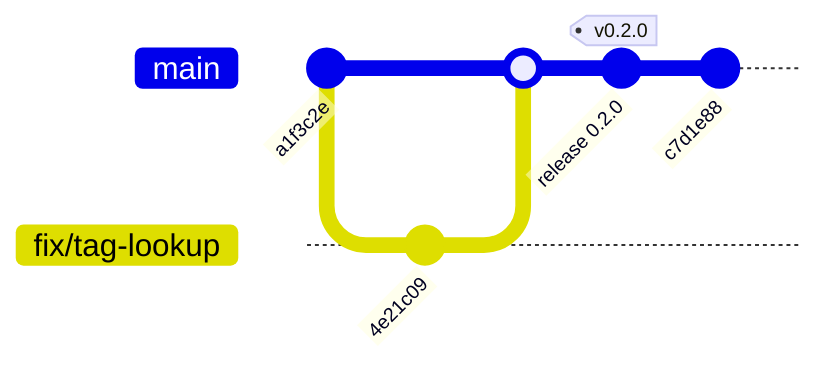

Presswerk turns repository release declarations into repeatable release work. One immutable
master record, the flake at an exact commit, is pressed into every published release.

:::caution
Presswerk is early, work-in-progress software. It releases itself, but its commands,
configuration, and output are not stable yet. Do not rely on it for production releases.
:::

A release is declared with `lib.mkRelease`, which evaluates a Nix module and produces plain data
at the `presswerk.default` flake output:

```nix
# flake.nix
{
  inputs.presswerk.url = "github:jkuball/presswerk";

  outputs = { self, presswerk, ... }: {
    presswerk.default = presswerk.lib.mkRelease {
      sourceRoot = self.outPath;
      versionFiles.cargo.my-crate = { };
      publishers.github-release.default.repository = "owner/project";
    };
  };
}
```

Run the CLI from the Presswerk input locked in your flake, so it matches your `mkRelease`:

```console
$ nix run --inputs-from . presswerk -- plan           # show the next release, write nothing
$ nix run --inputs-from . presswerk -- prepare        # create the release commit
$ nix run --inputs-from . presswerk -- publish HEAD   # tag and publish an exact candidate
```

The release commit carries the new version and frozen release notes, so CI builds and checks
the exact candidate before anything is published:


